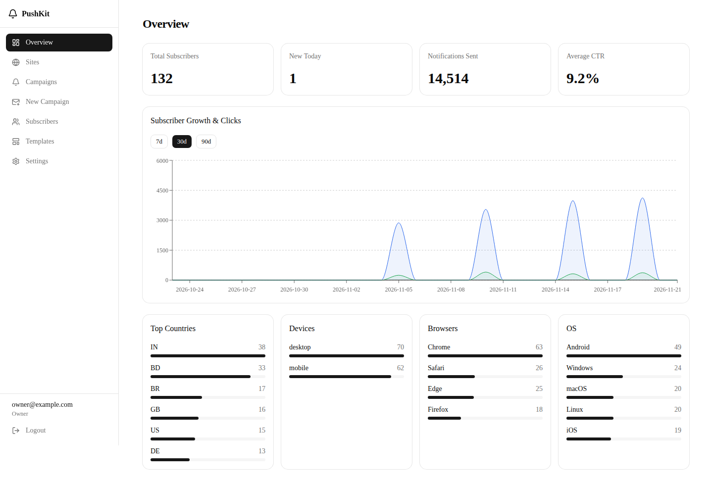
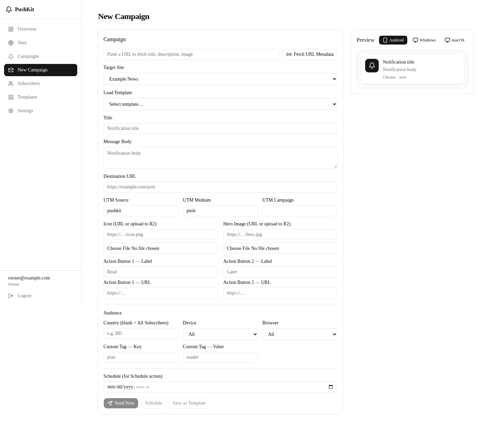
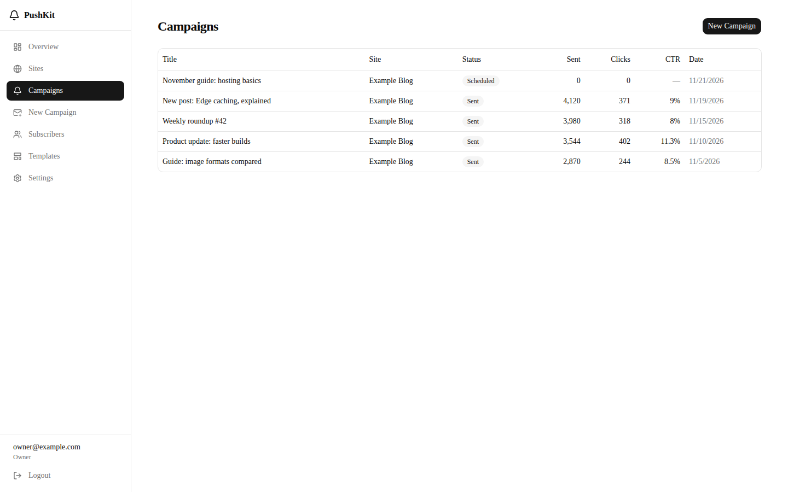
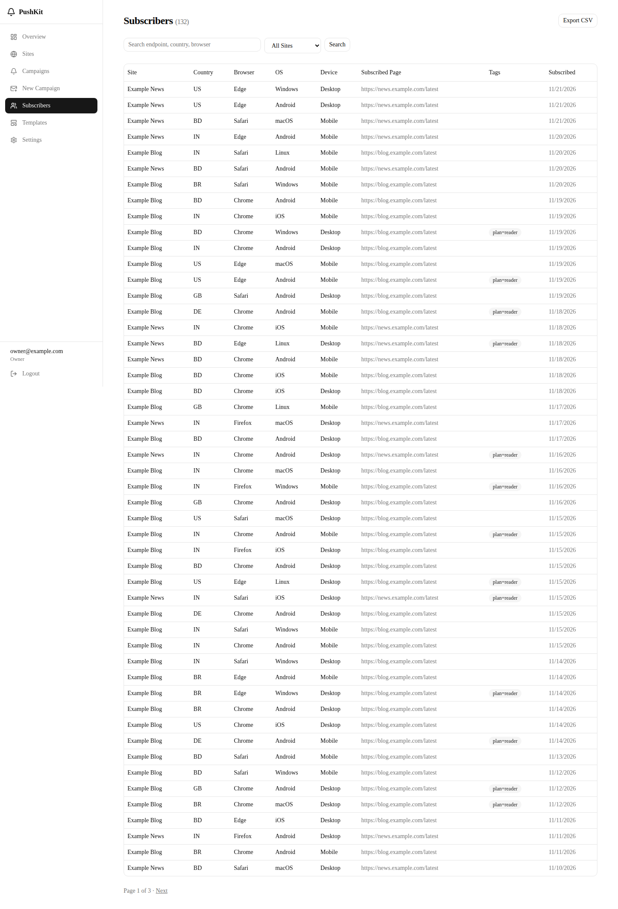
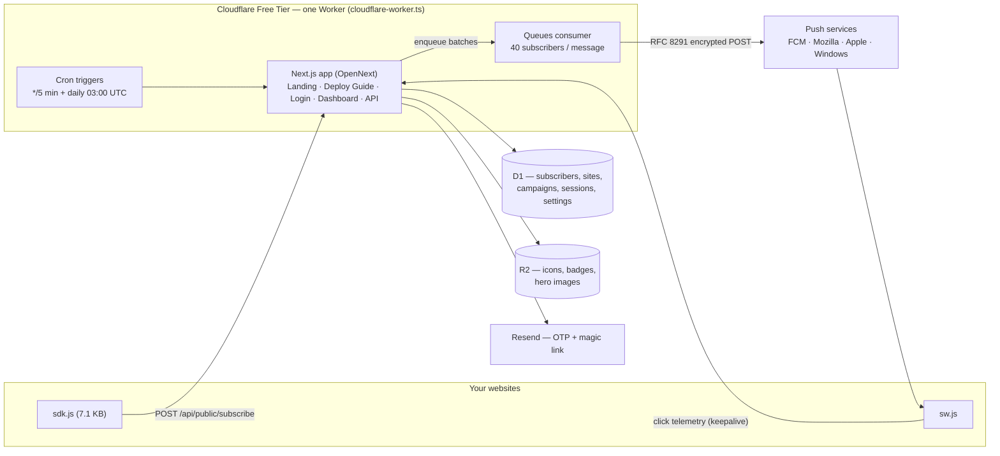

# PushKit

**Free, open-source, self-hosted web push notification platform.**
Send browser push notifications from your own Cloudflare account — unlimited subscribers, unlimited sites, no per-subscriber billing, full data ownership. Total running cost on the Cloudflare Free Tier: **$0/month**.

PushKit is the self-hosted alternative to OneSignal, PushEngage, VWO Engage, and LaraPush: the same composer, segmentation, auto-push, and analytics — running in your Cloudflare account, with every subscriber record in your own D1 database.

- **Live Site:** [https://pushkit.infy.workers.dev](https://pushkit.infy.workers.dev)
- **Documentation:** [/docs](https://pushkit.infy.workers.dev/docs)
- **Deployment Guide:** [/deploy](https://pushkit.infy.workers.dev/deploy)
- **Compare:** [/compare](https://pushkit.infy.workers.dev/compare)
- **Contributing:** [CONTRIBUTING.md](CONTRIBUTING.md)
- One install serves your own sites only. There is **no public sign-up**: one owner account, plus staff the owner invites.



## Capacity on the Cloudflare Free Tier

These numbers come from Cloudflare's published free limits and PushKit's batching design (40 subscribers per queue message, batched counters instead of per-delivery rows):

| Capacity | Free tier |
|---|---|
| Pushes per day | ≈130,000 (10,000 Queue operations/day, ~3 ops per delivered message of 40 subscribers) |
| Pushes per month | ≈4,000,000 |
| Subscribers stored | 1,000,000+ (500 MB D1 database, <500 bytes per subscriber row) |
| Sites | Unlimited (sites are D1 rows with their own VAPID key pair) |
| Images | Unlimited via public URLs or auto-fetched OpenGraph (zero cost) |
| Login email | 100/day on Resend free plan — only codes, magic links, and invites use email |
| Monthly cost | $0 |

## Features

Everything below is included in the install. No paid tiers, no feature gates.

### Campaign Composer

Build a notification the way you publish a post. Paste a URL and **Fetch URL Metadata** fills the title, description, and image from the page's Open Graph tags. Edit the title and message body, set the destination URL, and the **UTM builder** appends source, medium, and campaign parameters automatically. The icon and hero image can be pasted directly as public URLs or auto-filled from page Open Graph metadata. Add up to **two action buttons** (for example *Read* and *Later*), each with its own URL.

A **live preview** renders the notification in Android Chrome, Windows Desktop, and macOS styles as you type. When the campaign is ready: **Send Now** (queued and fanned out immediately), **Schedule** for a date and time, or **Save as Template**.



### Audience Targeting

Send to **all subscribers** of a site, or filter the audience by:

- **Country** — recorded from the Cloudflare edge (`request.cf.country`) at subscribe time
- **Device** — mobile / desktop
- **Browser** — Chrome, Firefox, Safari, Edge, …
- **Custom Tag** — key + value pairs set from your own pages

Tags come from your site, not a third-party tracker:

```html
<script>
  window.PushKit && window.PushKit.tag("plan", "reader");
</script>
```

The target count is calculated before the campaign is queued, and the campaign row records it next to the delivered count.

### Delivery Analytics

The overview dashboard shows the four numbers that matter — **Total Subscribers**, **New Today**, **Notifications Sent**, **Average CTR** — plus a subscriber growth and clicks chart switchable between **7 / 30 / 90 days**, and ranked breakdowns for **Top Countries, Devices, Browsers, and OS**.

Every campaign in the history table shows **Status, Sent, Clicks, and CTR %**. Clicks are reported by the service worker itself (`notificationclick` → `POST /api/public/click` with `keepalive`), so CTR reflects real notification clicks, not landing-page visits.

Click a campaign title for its **statistics page**: target audience, delivered, clicks, CTR, a **delivery breakdown** (delivered vs endpoint-gone 404/410 vs other errors), **clicks by day**, and the exact notification and audience used. The overview also breaks subscribers down by **push service** (Chrome/FCM, Apple, Windows, Firefox) from their endpoint hosts.



Delivery results are stored as **batched counters on the campaign row** — one D1 write per 40 deliveries instead of one row per delivery. That is what keeps a 130,000-push day inside the free 100,000 rows-written/day budget.

### Engagement Protection

Since October 2025, Chrome can **automatically revoke notification permission** for high-volume sites whose subscribers rarely interact. PushKit is built to keep you on the right side of that rule:

- **Engaged subscribers only** — a composer audience option that targets subscribers who clicked in the last 90 days (or subscribed in the last 30).
- **Per-subscriber pacing** — per-site caps: max notifications per subscriber per day (default 3) and a minimum gap between sends. Enforced inside the audience query, so no send can exceed them.
- **Health warnings** — the overview and every site card show 30-day CTR; below 1% at volume, a warning explains the risk and the fix.
- **Per-subscriber engagement data** — deliveries and clicks are tracked per subscriber (received count, click count, last clicked) with batched writes, never per-delivery rows.

### Auto-Push — RSS & Webhooks

**RSS / Atom:** give a site its feed URL and enable *Auto-Push New Posts*. The cron poller (every 5 minutes) fetches the feed with conditional GET (ETag / Last-Modified — unchanged feeds cost a 304), compares the newest item's GUID with the site's stored `last_pushed_guid`, and sends exactly one campaign per new post. The first poll only records the cursor — your backlog is never blasted to subscribers.

**Publish webhook:** every site gets `POST /api/webhooks/publish/:siteId`, authenticated with the site's `whsec_...` secret as a Bearer token or an HMAC-SHA256 signature. It accepts a Ghost `post.published` payload natively, or a generic JSON body:

```bash
curl -X POST https://push.example.com/api/webhooks/publish/SITE_ID \
  -H "Authorization: Bearer whsec_..." \
  -H "Content-Type: application/json" \
  -d '{ "title": "New post", "body": "Summary", "url": "https://example.com/post", "image": "https://example.com/hero.jpg" }'
# → 201 { "ok": true, "campaignId": "...", "targets": 1234 }
```

### Multi-Site, One Install

One PushKit install runs push for every site you own. Each site has:

- Its **own VAPID key pair** (generated on create, rotatable by the owner)
- Its **own opt-in prompt**: title, text, Allow / Not now labels, shown after a delay in seconds or at a scroll percentage
- Its **own subscriber list, feed, and webhook secret**

Integration per site is one script tag plus one file — see [Website Integration](#website-integration).

### Opt-In Prompt — Styles, Languages, A/B Tests, Welcome Push

- **Three prompt styles** per site: banner card, top bar, or a floating bell button.
- **Languages:** the SDK ships built-in prompt texts in **Bangla, Hindi, Spanish, and Portuguese** and picks by the visitor's browser language; per-language overrides are editable as JSON in the site settings.
- **A/B testing:** enable the 50/50 split and set a Variant B title/body — new subscribers are attributed to a variant and the overview shows opt-ins per variant.
- **Welcome notification:** an optional title/body/URL sent once to every brand-new subscriber, the moment they subscribe.
- **Win-back audiences:** the SDK pings a visit once a day per browser, so the composer can target *subscribers not seen in 7 / 14 / 30+ days* — and the same signal powers the 180-day cleanup.

### Subscriber Management

The subscribers table lists every endpoint with site, country, browser, OS, device, subscribed page URL, language, and tags. **Search** by endpoint, country, or browser; **filter** by site; **export CSV** for the full list.

Cleanup is automatic: any endpoint a push service reports as **404 / 410 Gone** is deleted during the send that discovers it, and subscribers not seen in **180 days** are purged by the daily cron. Endpoint values are masked in list APIs — full endpoints never render in the UI. Individual subscribers can be deleted from the table, and the owner can **export everything** (sites, subscribers with keys, campaigns, templates) as one JSON backup from Settings.

**Migrating from OneSignal or PushEngage?** Subscriptions are cryptographically bound to the VAPID key they were created with, so no tool can file-import an audience and keep sending to it. PushKit does the honest version: import the old export CSV (Subscribers → Import) to store the audience as records, set *Migrating from* in the site settings, and the SDK **silently re-subscribes returning visitors** under your keys — permission is already granted, so there is no prompt. The subscribers table shows each record flip from *Awaiting re-subscribe* to *Active* as your audience converts. The full guide is in the dashboard and in `docs/PLAN.md`.



### Templates

Recurring sends — *New post*, *Weekly roundup*, *Product update* — are saved as templates with title, body, URL, icon, hero image, and action buttons. One click in the composer loads a template, ready to edit and send.

### Team Access & Roles (RBAC)

There is no registration page. The **owner** signs in with a 6-digit email code or a magic link and invites **staff** with single-use links that expire in 72 hours.

| Capability | Owner | Staff |
|---|---|---|
| Compose, schedule, send campaigns | ✓ | ✓ |
| Templates, subscribers, analytics | ✓ | ✓ |
| View VAPID private key / webhook secret | ✓ | — |
| Rotate keys and secrets | ✓ | — |
| Manage team, sessions, Resend key | ✓ | — |
| Delete sites, purge subscribers | ✓ | — |

Role checks run server-side on every API route; secrets are never serialized into staff responses.

### Email Configuration (Resend)

Login codes, magic links, and staff invites are delivered by **Resend**. Configure it either way:

1. **Dashboard (recommended after first login):** Settings → **Email (Resend)** → paste the API key → Save. The key is stored **AES-GCM encrypted** in your D1 database (key derived from `SESSION_SECRET`), is never displayed back (only its last 4 characters), and a **Send Test Email** button verifies delivery. A From address can be set in the same form.
2. **Environment secret:** `wrangler secret put RESEND_API_KEY` — required before the *first* login, since the first login code is itself delivered by email.

A key saved in Settings takes priority over the environment secret. Removing it falls back to the secret.

### Delivery Engine

- **Standards-based:** payload encryption per subscriber follows **RFC 8291** (`aes128gcm`: ECDH → HKDF → AES-128-GCM) and VAPID authentication follows **RFC 8292** (ES256 JWT), implemented on **Web Crypto only** — no Node-only libraries in the send path, so it fits the Workers 10 ms CPU budget. An automated round-trip test (`npm run test:webpush`) encrypts a payload and decrypts it through an independent code path, and verifies the VAPID JWT signature.
- **Queue fan-out:** campaign audiences are chunked into **40 subscriber IDs per Queue message**, one message per consumer invocation — under the free tier's 50-subrequest-per-invocation limit, with headroom for the D1 read and counter write each message needs.
- **Self-cleaning:** 404/410 endpoints are deleted at send time; campaign status moves `queued → sending → sent` from the batched counters.

### Security Model

- **No public sign-up.** Owner bootstrapped from `OWNER_EMAIL`; staff exist only via owner invites.
- **Passwordless auth.** 6-digit OTP (10-minute expiry, max 5 attempts) + magic link. Codes, tokens, and session IDs are stored as **SHA-256 hashes** — raw values never touch the database.
- **Sessions:** random 256-bit token in an `HttpOnly`, `Secure`, `SameSite=Strict` cookie; 30-day sliding expiration; revocable per session in Settings.
- **Public endpoint hardening:** `Origin` must match the site's registered domain on subscribe/tag; push endpoints are validated against an allowlist (`fcm.googleapis.com`, `updates.push.services.mozilla.com`, `web.push.apple.com`, `*.notify.windows.com`) to block SSRF; webhooks verify Bearer secret or HMAC-SHA256 with timing-safe compare; per-IP rate limits on auth and subscribe; CSP, `X-Frame-Options: DENY`, and `nosniff` headers on all responses.
- **Settings secrets:** the dashboard-saved Resend key is AES-GCM encrypted at rest.

## Comparison

| | PushKit | OneSignal | PushEngage | LaraPush |
|---|---|---|---|---|
| Price | $0, self-hosted | Free ≤ 10k subscribers, then per-subscriber | From $19/mo | $499 one-time |
| Subscribers | Unlimited | Capped by plan | Capped by plan | Unlimited |
| Domains | Unlimited | Plan-based | Plan-based | Unlimited |
| Data ownership | Your D1 database | OneSignal servers | PushEngage servers | Your server |
| Hosting | Cloudflare Free Tier | SaaS | SaaS | PHP server |
| Source | MIT, open | Closed | Closed | Closed |

## Architecture



```
Browser ── sdk.js ──► /api/public/config (VAPID public key, prompt config)
        └─ registers /sw.js on the site origin, PushManager.subscribe()
        └─ POST /api/public/subscribe ──► D1 subscribers (+ tags)

Dashboard ── POST /api/campaigns (Send Now)
        └─ audience query ──► subscriber IDs ──► chunk(40) ──► Queue messages
Queue consumer ── per message: encrypt per subscriber (ECDH → HKDF → AES-128-GCM),
        sign VAPID JWT (ES256), POST to push service,
        one batched counter UPDATE per message, delete 404/410 endpoints
sw.js ── push event: showNotification ── notificationclick: POST /api/public/click
Cron */5 ── due scheduled campaigns + RSS polling
Cron 03:00 ── purge subscribers not seen in 180 days
```

### Repository layout

| Path | Contents |
|---|---|
| `src/app/` | Landing, `/deploy` guide, login, dashboard pages, API route handlers |
| `src/app/api/public/` | `config`, `subscribe`, `click`, `tag` — public SDK endpoints |
| `src/app/api/settings/email/` | Resend key status / save / remove / test (owner only) |
| `src/app/api/webhooks/publish/[siteId]/` | Publish webhook |
| `src/lib/push/webpush.ts` | VAPID + `aes128gcm` engine (Web Crypto only) |
| `src/lib/push/fanout.ts` | Queue fan-out (40/message) + batch delivery |
| `src/lib/push/service-worker.ts` | Generated `sw.js` source |
| `src/lib/store.ts` | Data layer: D1 implementation + in-memory demo store for local dev |
| `src/lib/auth.ts` | OTP / magic link / invite flow, D1 sessions, RBAC |
| `src/lib/email-config.ts` | Resend key resolution: Settings (encrypted) → environment secret |
| `src/lib/cron.ts` | Scheduled campaigns, RSS polling, purge |
| `cloudflare-worker.ts` | Worker entry: `fetch` (Next.js) + `queue` + `scheduled` |
| `migrations/` | D1 schema (`0001_initial.sql`, `0002_settings.sql`) |
| `public/sdk.js` | Minified SDK (7.1 KB). Readable source: `sdk/sdk.js` |
| `public/screenshots/` | Dashboard screenshots used on the landing page and here |
| `wrangler.toml` | D1, R2, Queue (producer + consumer), Cron, vars |
| `tests/webpush.roundtrip.ts` | Independent decrypt + JWT verify test |

UI: Next.js (App Router) + TypeScript + Tailwind CSS v4 + shadcn/ui on Base UI, using the **@7ovr registry** (`components.json` → `"@7ovr": "https://7ovr.com/r/{name}.json"`). Installed blocks: `@7ovr/dashboard`, `@7ovr/app-shell-3`, `@7ovr/dashboard-1`, `@7ovr/charts-3`, `@7ovr/table-1`, `@7ovr/auth-8` (adapted — sign-up removed, OTP login), `@7ovr/error-1`, `@7ovr/error-2`, `@7ovr/header-2`, `@7ovr/features-1`, `@7ovr/features-3`, `@7ovr/faqs-2`, `@7ovr/footer-1`. Icons: Lucide React only. Research notes: [RESEARCH.md](RESEARCH.md).

## Deployment

The full guide — including the free-tier capacity math and a post-deploy checklist — is on the **`/deploy` page of any running install** and summarized here. For a step-by-step go-live with verification at each stage, follow **[docs/LAUNCH.md](docs/LAUNCH.md)**.

Prerequisites: Node.js 20+, a Cloudflare account (free), a Resend account (free).

```bash
git clone https://github.com/zhshimul815/pushkit.git
cd pushkit
npm install
npx wrangler login

# D1: create, paste the returned database_id into wrangler.toml, migrate
npx wrangler d1 create pushkit-db
npm run db:migrate:remote

# Queues (campaign delivery fan-out)
npx wrangler queues create pushkit-send
npx wrangler queues create pushkit-dlq

# Optional: R2 for direct image uploads (uncomment in wrangler.toml if enabled)
# npx wrangler r2 bucket create pushkit-media
```

Edit `wrangler.toml` → `[vars]`, then set the Resend secret (**before first deploy** — the first login code is delivered by email; verify the `EMAIL_FROM` domain in Resend first):

```toml
NEXT_PUBLIC_APP_URL = "https://push.example.com"
OWNER_EMAIL = "you@example.com"
EMAIL_FROM = "PushKit <auth@yourdomain.com>"
VAPID_SUBJECT = "mailto:you@example.com"
```

```bash
npx wrangler secret put RESEND_API_KEY
npx wrangler secret put SESSION_SECRET   # recommended: salts hashes, encrypts the Settings-stored Resend key
npm run deploy
```

Open `https://push.example.com/login`, enter `OWNER_EMAIL`, and sign in with the emailed code. The first login creates the owner account. After that, the Resend key can be managed in **Dashboard → Settings → Email (Resend)**.

### Local development

```bash
cp .env.example .env.local   # set OWNER_EMAIL; RESEND_API_KEY optional
npm run dev                   # http://localhost:3000
```

With no Resend key configured anywhere, login codes print to the server log and are returned in the API response (`devCode`, non-production only) so local login works. Without Cloudflare bindings, the app uses an in-memory demo store (seeded sites, subscribers, campaigns) — data resets on restart. For real local D1/R2/Queues: `npm run db:migrate:local`, then `npm run preview:cf`.

### Verify the push engine

```bash
npm run test:webpush
# ✓ RFC 8291 aes128gcm encrypt → decrypt round trip
# ✓ RFC 8292 VAPID ES256 JWT sign → verify
```

## Website Integration

### Any HTML site

1. Dashboard → Sites → Add Site (domain, e.g. `blog.example.com`).
2. Download `sw.js` from the site card and place it at the root of your domain: `https://blog.example.com/sw.js` (service workers must be same-origin with the site — this file is the only thing hosted outside PushKit).
3. Add the snippet before `</body>`:

```html
<script src="https://push.example.com/sdk.js" data-site-id="YOUR_SITE_ID" async></script>
```

Optional: custom service worker path — `data-sw-path="/push/sw.js"`.

### WordPress

Use the **PushKit Web Push plugin** in `wordpress/pushkit-web-push/` (also the source for the wordpress.org listing): enter your PushKit URL, Site ID, and webhook secret under *Settings → PushKit*. The plugin injects the snippet, serves the service worker at `/pushkit-sw.js`, and can auto-push every new post through the publish webhook. Manual alternative: add the snippet with a header/footer plugin, upload `sw.js` to the WordPress root, and use RSS Auto-Push with your feed URL (`https://example.com/feed`).

### Ghost

Settings → Code injection → Site Footer: paste the snippet. Upload `sw.js` to your server root — or skip RSS and use the webhook: Settings → Integrations → Add custom integration → Webhooks → `post.published` → target `https://push.example.com/api/webhooks/publish/YOUR_SITE_ID`, header `Authorization: Bearer whsec_...`.

### Substack / hosted platforms

Platforms that allow custom JavaScript accept the snippet, but `sw.js` must be served from the same origin, which hosted platforms may not allow — on those, subscriptions are limited by the platform, not by PushKit.

### Next.js

```tsx
import Script from "next/script";

<Script src="https://push.example.com/sdk.js" data-site-id="YOUR_SITE_ID" strategy="afterInteractive" />
```

Serve the downloaded file as `public/sw.js`.

## API Reference

Full reference — every endpoint, auth model, request/response shapes, rate limits and the webhook signature scheme: **[docs/API.md](docs/API.md)**. Summary tables:

### Public endpoints (used by sdk.js / sw.js)

| Endpoint | Auth | Purpose |
|---|---|---|
| `GET /api/public/config?siteId=` | Public | VAPID public key + opt-in prompt config |
| `POST /api/public/subscribe` | Origin must match site domain | Store subscription `{ siteId, subscription: { endpoint, keys: { p256dh, auth } }, pageUrl, language, tags }` |
| `POST /api/public/tag` | Origin must match site domain | `window.PushKit.tag()` updates `{ siteId, endpoint, tags }` |
| `POST /api/public/click` | Public | Click telemetry `{ campaignId, subscriberId }` from `sw.js` |
| `POST /api/public/visit` | Origin must match site domain | Daily visit ping `{ siteId, endpoint }` from `sdk.js` (win-back + list cleaning) |
| `GET /sw.js?siteId=` | Public | Downloadable service worker for the site |

### Webhook

`POST /api/webhooks/publish/:siteId` — `Authorization: Bearer whsec_...` or `X-PushKit-Signature: sha256=<HMAC-SHA256(secret, raw body)>`. Ghost `post.published` payloads are detected automatically (`post.current.title / excerpt / url / feature_image`). Response: `201 { "ok": true, "campaignId": "...", "targets": 1234 }`.

### Admin API (session cookie; role-checked)

Sites, campaigns (incl. `fetch-metadata`), subscribers (+ `?export=csv`, `POST /api/subscribers/import`, `DELETE /api/subscribers/:id`), templates, team, uploads to R2 (`POST /api/upload`, images ≤ 2 MB), media proxy (`GET /api/media/...`), settings (`POST /api/settings/purge`, `GET /api/settings/export`, `GET|POST|DELETE /api/settings/email`, `POST /api/settings/email/test`).

## Free-Tier Limits to Know

| Resource | Free limit | PushKit usage |
|---|---|---|
| Workers requests | 100,000 / day | App + API + consumer |
| Worker CPU | 10 ms / invocation | Web Crypto push engine, no heavy dependencies |
| Subrequests | 50 / invocation | 30 push fetches per queue message |
| Queue operations | 10,000 / day | ~3 ops per message → ≈130,000 deliveries / day |
| D1 rows written | 100,000 / day | Batched counters; ~1 write per 40 deliveries |
| D1 storage | 500 MB | 1,000,000+ subscriber rows |
| R2 storage | 10 GB | Notification images only |

Exceeding a daily limit pauses that resource until the daily reset; no data is lost. Paid plans raise every limit without code changes.

## License

[MIT License](LICENSE) — Copyright (c) 2026 PushKit contributors. Free for individuals, businesses, and developers to use, modify, distribute, and self-host.
